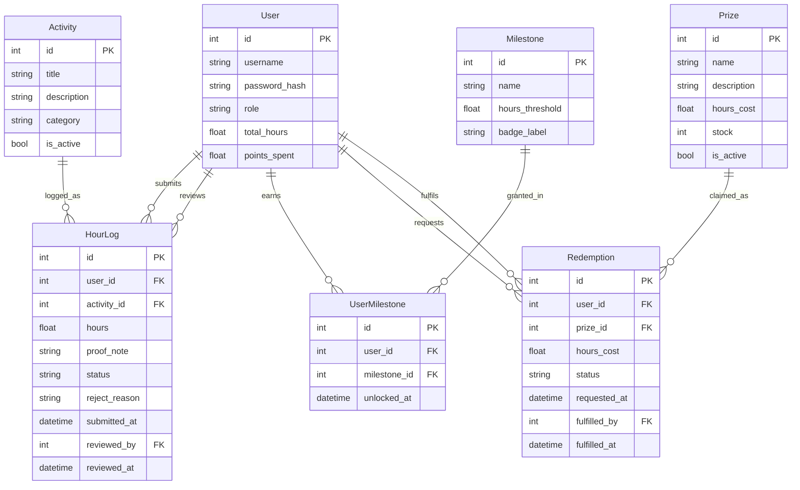

# COMP 3613 Assignment 1

Draft this file with the Guide. **Update it after every phase milestone** before you pause. The use-case diagram is a UML PNG at `docs/diagrams/use-case.png`, linked from this file as `diagrams/use-case.png` (path relative to `docs/report.md`). The model diagram is Mermaid. **Embed wireframe images** as `wireframes/<file>` (files live in `docs/wireframes/`).

Do not put your student ID in this file if you will commit it. The PDF cover adds your name and ID at export time.

## Assigned project

Student Awards (incentive system).

Students log volunteer hours, appear on a leaderboard, unlock milestones, and redeem progress for prizes. Admins review hours and fulfil redemptions.

## Three workflows

### 1. Log and approve volunteer hours (Student, Admin)

Student picks an activity, enters hours and a short proof note, and submits as pending. Admin sees the pending queue, then approves or rejects with a reason. Done when the entry shows approved or rejected, and the student's total hours update on approval.

### 2. Leaderboard and milestones (Student)

Student opens the leaderboard, sees their rank by approved hours, and views their milestone progress. Crossing an hour threshold unlocks a milestone badge. Done when rank and unlocked milestones reflect the latest approved hours.

### 3. Redeem a prize (Student, Admin)

Student browses prizes, redeems one they have enough hours for, and the hours cost is deducted. Admin sees the redemption request and marks it fulfilled. Done when the student's balance drops and the redemption shows fulfilled.

## Use case diagram


Notes (Phase 2): Student and Admin sit on opposite sides. Each named step is its own actor association (no «include» / «extend»). **Log in** is the only shared use case. Leaderboard and milestones are two ellipses because the Phase 1 name lists both. Prize browse shows locked (not redeemable) items when hours are short — that is behaviour on Redeem a prize, not a separate ellipse.

## Model diagram

First draft from the student’s entities, properties, and relationship answers. Update this section in Phase 5 when polish revises the model, and note what changed.



Relationship and edge-case notes:

- `HourLog.user_id` is the student who submitted; `HourLog.reviewed_by` is a nullable FK to User (admin) until review.
- `Redemption.user_id` is the student who requested; `Redemption.fulfilled_by` is a nullable FK to User (admin) until fulfilment.
- `UserMilestone` is the bridge for User many-to-many Milestone; `(user_id, milestone_id)` is unique; `unlocked_at` is the first unlock and it stays.
- Same prize may be redeemed more than once while `stock` allows; stock decrements on redeem; at 0 the Redeem control is disabled (out of stock).
- Leaderboard ranks on all approved hours (`total_hours`, derived from approved `HourLog` rows). Redeeming never lowers rank or unlocked milestones. Redeemable balance is `total_hours` minus `points_spent`.
- Assumption: `HourLog.activity_id` is required; `User.role` is student/admin; `HourLog.status` is pending/approved/rejected; `Redemption.status` is requested/fulfilled.

```text
Phase 3 done
Artefact: docs/report.md
Base confidence: 0.82
Questions: 4/5
Suspicion: none
Skips: 0/3 used
Report: updated
```

## Theming (Phase 5)

- Colors: **Navy** primary (`#031627`) with **Gold** accent (`#d4af37`) and light surfaces (`#ffffff`).
- Type: clean sans-serif (`Inter`, system UI) for display and body.
- Tone: friendly and encouraging — short, positive microcopy and helpful CTAs.
- Wordmark: **Student Awards** (use as the site brand/wordmark).

These tokens are applied in `app/static/css/app.css` and carried to `landing.html`, `login.html`, and `register.html`.

## Wireframes

Embed each student-crafted wireframe here (Phase 4). Paths are relative to this file.

### 1. Log in


<!-- student-build:wireframe-coverage
use_case: Log in
image: docs/wireframes/1. Log in.png
covered: yes
-->

### 2. Log volunteer hours (Student)

.png)

<!-- student-build:wireframe-coverage
use_case: Log and approve volunteer hours (student side)
image: docs/wireframes/2. Log volunteer hours (Student).png
covered: yes
-->

### 3. Approve volunteer hours (Admin)

.png)

<!-- student-build:wireframe-coverage
use_case: Log and approve volunteer hours (admin side)
image: docs/wireframes/3. Approve volunteer hours (Admin).png
covered: yes
-->

### 4. View leaderboard


<!-- student-build:wireframe-coverage
use_case: Leaderboard and milestones
image: docs/wireframes/4. View leaderboard.png
covered: yes
-->

### 5. View milestones


<!-- student-build:wireframe-coverage
use_case: Leaderboard and milestones (milestones view)
image: docs/wireframes/5. View milestones.png
covered: yes
-->

### 6. Redeem a prize


<!-- student-build:wireframe-coverage
use_case: Redeem a prize
image: docs/wireframes/6. Redeem a prize.png
covered: yes
-->

### 7. Fulfil redemption (Admin)

.png)

<!-- student-build:wireframe-coverage
use_case: Redeem a prize (admin fulfilment)
image: docs/wireframes/7. Fulfil redemption (Admin).png
covered: yes
-->

`python manage.py report` also embeds any PNG/JPG still missing from `docs/wireframes/`.

## Phase 4 — Model suggestions from wireframes

List of suggested model properties observed directly on the wireframes (apply if you accept):

- `HourLog.proof_note` — seen on docs/wireframes/2. Log volunteer hours (Student).png
- `HourLog.status` — seen on docs/wireframes/3. Approve volunteer hours (Admin).png
- `HourLog.submitted_at` — seen on docs/wireframes/2. Log volunteer hours (Student).png
- `HourLog.reviewed_at` — seen on docs/wireframes/3. Approve volunteer hours (Admin).png
- `HourLog.reviewed_by` — seen on docs/wireframes/3. Approve volunteer hours (Admin).png
- `User.total_hours` — seen on docs/wireframes/4. View leaderboard.png
- `Milestone.badge_label` — seen on docs/wireframes/5. View milestones.png
- `Prize.hours_cost` — seen on docs/wireframes/6. Redeem a prize.png
- `Prize.stock` — seen on docs/wireframes/6. Redeem a prize.png
- `Redemption.status` — seen on docs/wireframes/7. Fulfil redemption (Admin).png
- `Redemption.requested_at` — seen on docs/wireframes/6. Redeem a prize.png
- `Redemption.fulfilled_at` — seen on docs/wireframes/7. Fulfil redemption (Admin).png
- `Redemption.fulfilled_by` — seen on docs/wireframes/7. Fulfil redemption (Admin).png

Notes:
- Leaderboard rank is derived from approved `HourLog` rows; consider computing `User.rank` at query time rather than storing it.
- If prizes have limited stock, ensure redemption processing decrements `Prize.stock` atomically and validates availability at request time.
- Confirm whether redeeming a prize deducts from `User.total_hours` or tracks `points_spent` separately (suggest `points_spent` to preserve historical totals).

## Phase 4 decisions applied

The student accepted the following choices and they have been applied to the model draft and code:

- **Track spent points separately:** redeeming never changes `User.total_hours`. Redeeming adds the prize's `hours_cost` to `User.points_spent`. `Redemption` rows keep `hours_cost`. Redeemable balance = `total_hours - points_spent`.
- **Admin review rules:** admins cannot edit submitted `HourLog` entries; they may only set status to `approved` or `rejected` and provide a `reject_reason` when rejecting.
- **Prize stock enforcement:** `Prize.stock` is enforced atomically at redeem time (decrement on redemption; block redemptions at 0). No reservation/timeout semantics.

These decisions prompted adding `total_hours` and `points_spent` fields to the `User` model in `app/models/user.py`.

## Theming

Branding preferences and how they were applied (landing / login / register).

## Implementation notes

One named workflow at a time. Include verify notes and polish / model revisions (Phase 5). Do not treat the first build as final.

## Deployed app

Phase 6. Public Render URL (not localhost). Markers open this to mark the three workflows.

https://

## Logins

Every account a marker needs, including extra users you added. Starter accounts:

- bob / bobpass — regular user
- admin / adminpass — admin

## YouTube URL

## Session transcripts

Filled when the Guide builds the report: the agent writes each Guide chat to `docs/transcripts/<slug>.md` (Copilot Agent, Cursor, or OpenCode). `python manage.py report` packages them. Do not paste chats here during the build.

## Competency (student-judge)

Filled when the report is built. Guide runs student-judge, writes `docs/judge.md`, and export appends the scorecard here.

## Skill integrity

Filled by `python manage.py report`. Do not edit the course skills.
