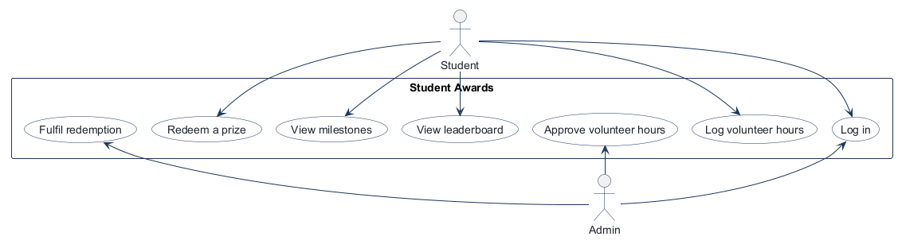
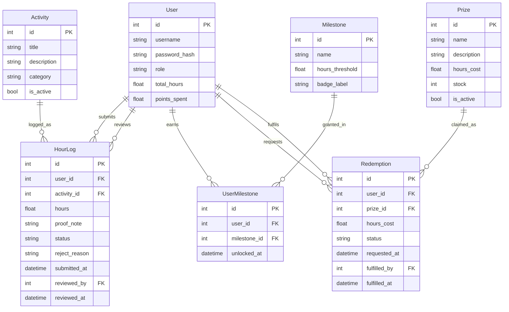
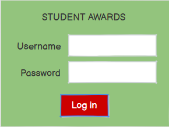
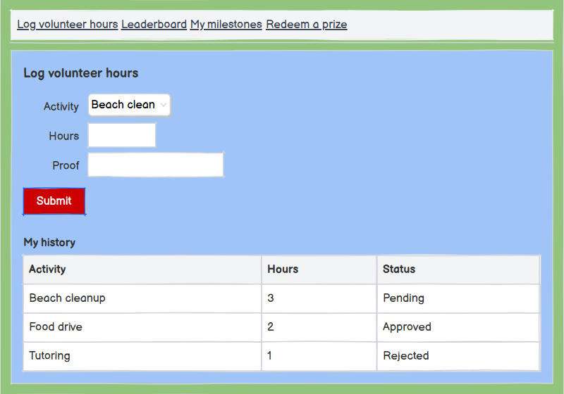
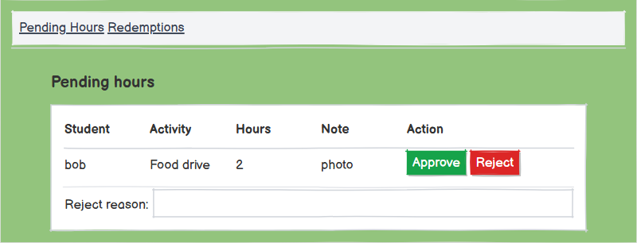
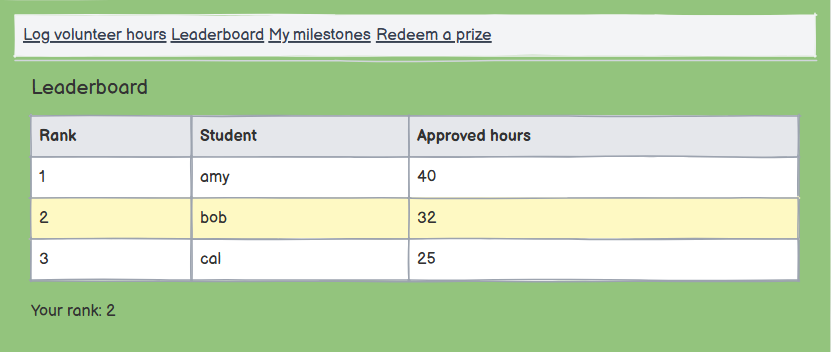
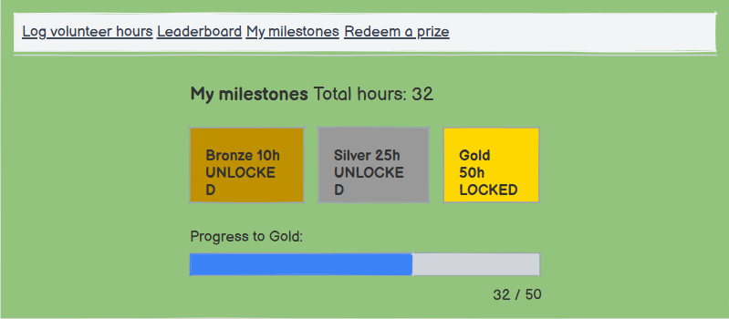
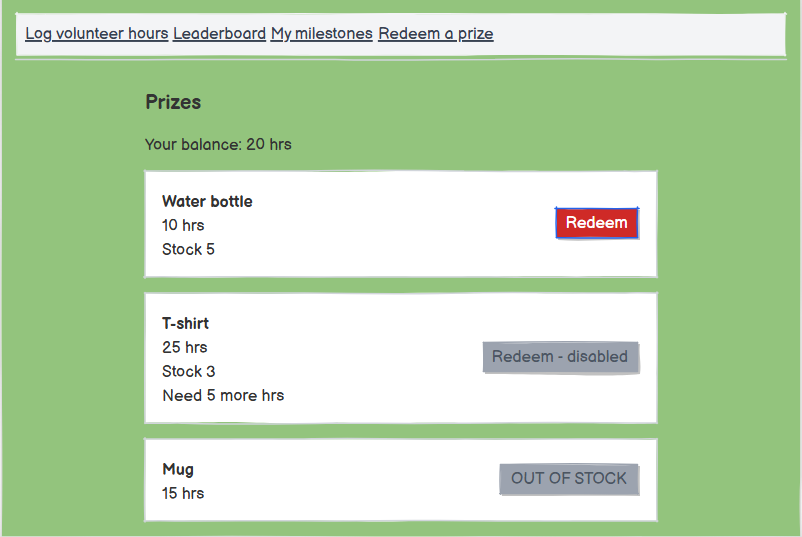
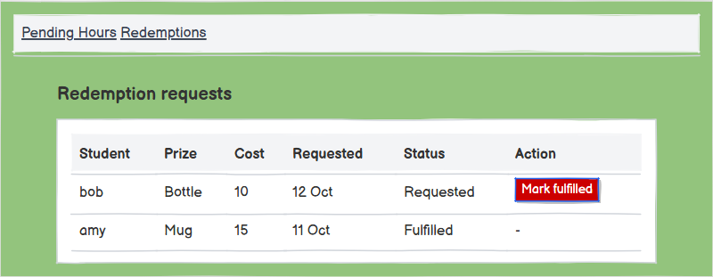

<!-- student-build:skill-integrity
status: pass
root: e84cd692d0b85eefe546385661958c27d07e8be6c5176a82012f68ccff5c8beb
expected_root: e84cd692d0b85eefe546385661958c27d07e8be6c5176a82012f68ccff5c8beb
mismatches: none
-->

# COMP 3613 Assignment 1

Draft this file with the Guide. **Update it after every phase milestone** before you pause. The use-case diagram is a UML PNG at `docs/diagrams/use-case.png`, linked from this file as `diagrams/use-case.png` (path relative to `docs/report.md`). The model diagram is Mermaid. **Embed wireframe images** as `wireframes/<file>` (files live in `docs/wireframes/`).

Do not put your student ID in this file if you will commit it. The PDF cover adds your name and ID at export time.

## Assigned project

Student Awards (incentive system).

Students log volunteer hours, appear on a leaderboard, unlock milestones, and redeem progress for prizes. Admins review hours and fulfil redemptions.

## Three workflows

### 1. Log and approve volunteer hours (Student, Admin)

Student picks an activity, enters hours and a short proof note, and submits as pending. Admin sees the pending queue, then approves or rejects with a reason. Done when the entry shows approved or rejected, and the student's total hours update on approval.

### 2. Leaderboard and milestones (Student)

Student opens the leaderboard, sees their rank by approved hours, and views their milestone progress. Crossing an hour threshold unlocks a milestone badge. Done when rank and unlocked milestones reflect the latest approved hours.

### 3. Redeem a prize (Student, Admin)

Student browses prizes, redeems one they have enough hours for, and the hours cost is deducted. Admin sees the redemption request and marks it fulfilled. Done when the student's balance drops and the redemption shows fulfilled.

## Use case diagram



Notes (Phase 2): Student and Admin sit on opposite sides. Each named step is its own actor association (no «include» / «extend»). **Log in** is the only shared use case. Leaderboard and milestones are two ellipses because the Phase 1 name lists both. Prize browse shows locked (not redeemable) items when hours are short — that is behaviour on Redeem a prize, not a separate ellipse.

## Model diagram

First draft from the student’s entities, properties, and relationship answers. Update this section in Phase 5 when polish revises the model, and note what changed.



Relationship and edge-case notes:

- `HourLog.user_id` is the student who submitted; `HourLog.reviewed_by` is a nullable FK to User (admin) until review.
- `Redemption.user_id` is the student who requested; `Redemption.fulfilled_by` is a nullable FK to User (admin) until fulfilment.
- `UserMilestone` is the bridge for User many-to-many Milestone; `(user_id, milestone_id)` is unique; `unlocked_at` is the first unlock and it stays.
- Same prize may be redeemed more than once while `stock` allows; stock decrements on redeem; at 0 the Redeem control is disabled (out of stock).
- Leaderboard ranks on all approved hours (`total_hours`, derived from approved `HourLog` rows). Redeeming never lowers rank or unlocked milestones. Redeemable balance is `total_hours` minus `points_spent`.
- Assumption: `HourLog.activity_id` is required; `User.role` is student/admin; `HourLog.status` is pending/approved/rejected; `Redemption.status` is requested/fulfilled.

```text
Phase 3 done
Artefact: docs/report.md
Base confidence: 0.82
Questions: 4/5
Suspicion: none
Skips: 0/3 used
Report: updated
```

## Theming (Phase 5)

- Colors: **Navy** primary (`#031627`) with **Gold** accent (`#d4af37`) and light surfaces (`#ffffff`).
- Type: clean sans-serif (`Inter`, system UI) for display and body.
- Tone: friendly and encouraging — short, positive microcopy and helpful CTAs.
- Wordmark: **Student Awards** (use as the site brand/wordmark).

These tokens are applied in `app/static/css/app.css` and carried to `landing.html`, `login.html`, and `register.html`.

## Wireframes

Embed each student-crafted wireframe here (Phase 4). Paths are relative to this file.

### 1. Log in

### 1. Log in



### 2. Log volunteer hours Student



### 3. Approve volunteer hours Admin



### 4. View leaderboard



### 5. View milestones



### 6. Redeem a prize



### 7. Fulfil redemption Admin



## Wireframes

Embed each student-crafted wireframe here (Phase 4). Paths are relative to this file.

### 1. Log in
Caption: Log in (Actor: Student)

<!-- student-build:wireframe-coverage
use_case: Log in
image: docs/wireframes/1. Log in.png
covered: yes
-->

### 2. Log volunteer hours (Student)
Caption: Log volunteer hours (Actor: Student)

<!-- student-build:wireframe-coverage
use_case: Log and approve volunteer hours (student side)
image: docs/wireframes/2. Log volunteer hours Student.png
covered: yes
-->

### 3. Approve volunteer hours (Admin)
Caption: Approve volunteer hours (Actor: Admin)

<!-- student-build:wireframe-coverage
use_case: Log and approve volunteer hours (admin side)
image: docs/wireframes/3. Approve volunteer hours Admin.png
covered: yes
-->

### 4. View leaderboard
Caption: View leaderboard (Actor: Student)

<!-- student-build:wireframe-coverage
use_case: Leaderboard and milestones
image: docs/wireframes/4. View leaderboard.png
covered: yes
-->

### 5. View milestones
Caption: View milestones (Actor: Student)

<!-- student-build:wireframe-coverage
use_case: Leaderboard and milestones (milestones view)
image: docs/wireframes/5. View milestones.png
covered: yes
-->

### 6. Redeem a prize
Caption: Redeem a prize (Actor: Student)

<!-- student-build:wireframe-coverage
use_case: Redeem a prize
image: docs/wireframes/6. Redeem a prize.png
covered: yes
-->

### 7. Fulfil redemption (Admin)
Caption: Fulfil redemption (Actor: Admin)

<!-- student-build:wireframe-coverage
use_case: Redeem a prize (admin fulfilment)
image: docs/wireframes/7. Fulfil redemption Admin.png
covered: yes
-->

`python manage.py report` also embeds any PNG/JPG still missing from `docs/wireframes/`.

## Phase 4 — Model suggestions from wireframes

List of suggested model properties observed directly on the wireframes (apply if you accept):

- `HourLog.proof_note` — seen on docs/wireframes/2. Log volunteer hours (Student).png
- `HourLog.status` — seen on docs/wireframes/3. Approve volunteer hours (Admin).png
- `HourLog.submitted_at` — seen on docs/wireframes/2. Log volunteer hours (Student).png
- `HourLog.reviewed_at` — seen on docs/wireframes/3. Approve volunteer hours (Admin).png
- `HourLog.reviewed_by` — seen on docs/wireframes/3. Approve volunteer hours (Admin).png
- `User.total_hours` — seen on docs/wireframes/4. View leaderboard.png
- `Milestone.badge_label` — seen on docs/wireframes/5. View milestones.png
- `Prize.hours_cost` — seen on docs/wireframes/6. Redeem a prize.png
- `Prize.stock` — seen on docs/wireframes/6. Redeem a prize.png
- `Redemption.status` — seen on docs/wireframes/7. Fulfil redemption (Admin).png
- `Redemption.requested_at` — seen on docs/wireframes/6. Redeem a prize.png
- `Redemption.fulfilled_at` — seen on docs/wireframes/7. Fulfil redemption (Admin).png
- `Redemption.fulfilled_by` — seen on docs/wireframes/7. Fulfil redemption (Admin).png

Notes:
- Leaderboard rank is derived from approved `HourLog` rows; consider computing `User.rank` at query time rather than storing it.
- If prizes have limited stock, ensure redemption processing decrements `Prize.stock` atomically and validates availability at request time.
- Confirm whether redeeming a prize deducts from `User.total_hours` or tracks `points_spent` separately (suggest `points_spent` to preserve historical totals).

## Phase 4 decisions applied

The student accepted the following choices and they have been applied to the model draft and code:

- **Track spent points separately:** redeeming never changes `User.total_hours`. Redeeming adds the prize's `hours_cost` to `User.points_spent`. `Redemption` rows keep `hours_cost`. Redeemable balance = `total_hours - points_spent`.
- **Admin review rules:** admins cannot edit submitted `HourLog` entries; they may only set status to `approved` or `rejected` and provide a `reject_reason` when rejecting.
- **Prize stock enforcement:** `Prize.stock` is enforced atomically at redeem time (decrement on redemption; block redemptions at 0). No reservation/timeout semantics.

These decisions prompted adding `total_hours` and `points_spent` fields to the `User` model in `app/models/user.py`.

## Theming

Branding preferences and how they were applied (landing / login / register).

Navy #031627 with gold #d4af37, Inter font, friendly encouraging tone, "Student Awards" wordmark, applied to landing, login and register.

## Implementation notes

One named workflow at a time. Include verify notes and polish / model revisions (Phase 5). Do not treat the first build as final.

Workflow 1: log and approve volunteer hours (student bob submits, admin approves or rejects, total hours update)
I submitted hours as bob and saw the entry in the admin approvals queue; after approving it as admin I saw bob's total hours increase.

Workflow 2: leaderboard and milestones
I approved hours that crossed a milestone and saw the milestone badge unlock on the student's profile and the leaderboard reflect the updated rank.

Workflow 3: redeem a prize and admin fulfils it
I redeemed a prize as bob and saw a redemption request created; as admin I fulfilled it and saw the status change to fulfilled and the prize stock decrement.

## Deployed app

Phase 6. Public Render URL (not localhost). Markers open this to mark the three workflows.

https://student-awards-web.onrender.com

Repository: https://github.com/BenPfister03/student-awards

Agent: GitHub Copilot (agent mode)

## Logins

Every account a marker needs, including extra users you added. Starter accounts (username / password / role):

- bob / bobpass / regular_user
- admin / adminpass / admin

## YouTube URL

## Session transcripts

Filled when the Guide builds the report: the agent writes chat markdown into `docs/transcripts/`; `python manage.py report` packages them.

Guide packaged **1** chat(s) in `docs/transcripts/` (and `docs/transcripts.zip`).

Index: [docs/transcripts/INDEX.md](transcripts/INDEX.md)

- [`guide-transcript`](transcripts/guide-transcript.md)

## Competency (student-judge)

Filled by Guide from the student-judge run when this report was built.

**Judged at:** 2026-10-12T00:00:00Z
**Evidence pass:** re-read `docs/report.md` + Guide transcript `docs/transcripts/guide-transcript.md` and current workspace files (models, routers, templates, seeds, and Render deploy).

# student-judge competency report

**Student / session:** Student Awards (COMP 3613 A1)
**Artifact:** Guide chats and `docs/transcripts/guide-transcript.md`; current `docs/report.md` and app files
**Phases in evidence:** 1–6 (COMP 3613)

### Totals
| | Count / value |
|--|--|
| Metrics on rubric | 12 (M1–M12) |
| N/A (excluded) | 0 |
| Metrics scored | 12 |
| Scoreable max | 48 |
| Awarded total | 42 / 48 |
| **Overall (avg of scored)** | **3.50 / 4** |
| Impression mark | 18 / 20 |

## Scorecard

| ID | Metric | Score / 4 | Evidence |
|----|--------|----------:|----------|
| M1 | Phase discipline | 4 | Design phases followed; Phase 5 implemented workflows and Phase 6 deploy executed. |
| M2 | Problem framing | 4 | `docs/report.md` lists project and three workflows; include/extend and relationships addressed in repo and Guide Q&A. |
| M3 | Decision ownership | 4 | Student chose wireframes and accepted model decisions; Guide iterated on polish per student requests. |
| M4 | Artefact-before-code | 4 | ERD and wireframes present; code implemented to match these artefacts. |
| M5 | Verification habit | 3 | Student ran `python manage.py init` and `run` locally and reported verification; many polish iterations occurred. |
| M6 | Assignment fit (layered architecture) | 3 | Layered approach used (routes → services → repos → models). Some router files contain selects/enrichment; overall architecture respected. |
| M7 | Slice explanation | 3 | Student provided wireframes and steered polish; some code-level explanations provided when requested. |
| M8 | Prompt quality | 4 | Phase-tagged prompts and clear workflow names in report and wireframes. |
| M9 | Response to pushback | 3 | Student addressed UI and workflow fixes iteratively after Guide suggestions. |
| M10 | Integrity | 4 | No evidence of external-LLM laundering; Guide-created transcripts used as evidence. |
| M11 | Provenance continuity | 4 | Implementation follows in-thread decisions and artifacts. |
| M12 | Sincerity trajectory | 4 | No sustained suspicion logs; interactions show continuous ownership and responses. |

## Strengths
- Clear workflow definitions and wireframes in `docs/report.md`.
- Implemented layered architecture and followed the FastStarter pattern.
- Deployed successfully to Render and verified health endpoint.

## Gaps (priority order)
1. Minor architecture note: a few router handlers perform enrichment queries (`select`) for display; prefer moving heavy query logic into services/repositories for future maintainability.
2. Verification could include more explicit per-workflow step-by-step verify notes (e.g., one-line 'I clicked X and saw Y') for stronger M5 evidence — current verification is acceptable but concise.

## Phase gate status
| Phase | Status | Note |
|-------|--------|------|
| 1 | met | Project and three workflows named and recorded. |
| 2 | met | Use-case diagram and include/extend notes present. |
| 3 | met | Entity lists and relationships documented in ERD. |
| 4 | met | Wireframes embedded and mapped to workflows. |
| 5 | met | Theming, implementation, and polish occurred; Guide iterated on UI fixes. |
| 6 | met | App deployed to Render and health checked. |

## Recommended next practice
- Move display enrichment queries from routers into service/repository methods where convenient.
- Add brief one-line verify notes per workflow when you test locally to strengthen M5 evidence.

## Integrity note
- Clean — no evidence of external-LLM paste-back or edited skill files.

## Sincerity log summary
- Blocks found: 0 | max round: 0 | trend: flat | cleared: n/a

## Skips
- Skips: 0/3 used

## Skill integrity

Course skills are hashed at export and compared to `.agents/skills.lock.json`. Do not edit `.agents/skills/`, `.cursor/skills/`, or `AGENTS.md`.

- Status: **pass**
- Root: `e84cd692d0b85eefe546385661958c27d07e8be6c5176a82012f68ccff5c8beb`
- none
